# WalimApp AI — Algerian wedding-hall marketplace with Meta Muse Spark

> **Hackathon prototype (Meta AI Developer Hackathon).** A responsive **web application** (not a native Android app) that lets couples
> describe their wedding in plain language, get venue recommendations from **Meta Muse Spark** grounded in real catalogue records,
> explore a hall in a 360° viewer, and send a booking inquiry that the hall owner accepts or rejects from a dashboard.
>
> **All venues are fictional sample records.** No real hall, price, availability, person or booking is represented.

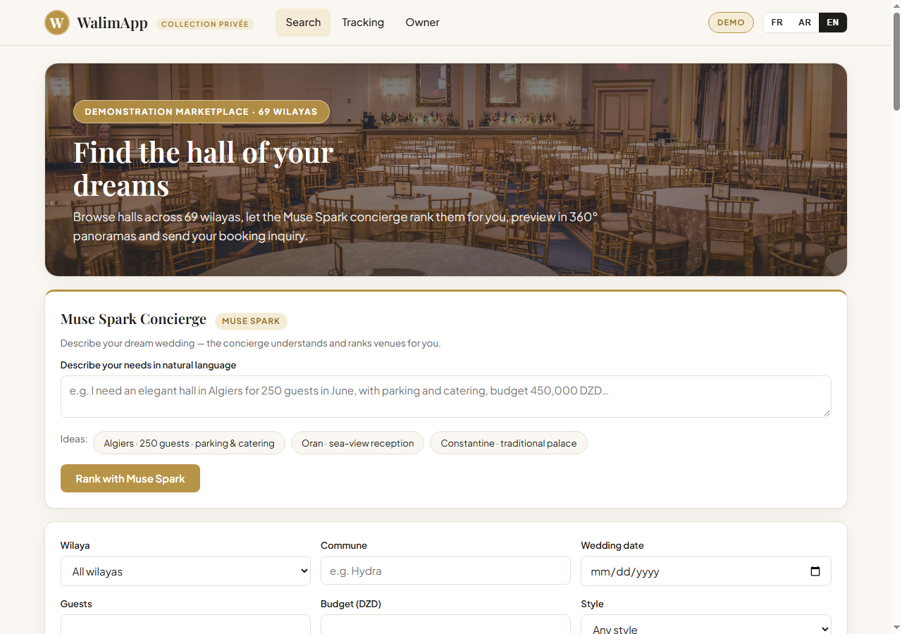

## 1. Product Overview

WalimApp AI is an **Algerian wedding hall discovery marketplace**: couples describe their wedding in plain language
(French, Arabic or English) and get ranked venue recommendations with honest explanations, then track a booking inquiry
until the hall owner answers.

- **trilingual FR/AR/EN support** with full Arabic RTL layout, responsive from 375 px phones to desktop.
- **69 Wilayas** with commune, date, guest-count, budget, style and amenity filters.
- **interactive 360° panoramas** (Pannellum viewer with a generic sample panorama demonstrating the viewer).
- **customer booking accounts**: register, log in, send inquiries linked to your account, and follow them in a
  customer-isolated booking dashboard (`My bookings`).
- **operational owner triage workspace**: authenticated owner inbox with status/hall/date filters, summary tiles,
  accept/reject decisions with an optional note, and conflict protection (one confirmed booking per hall/date).

## 2. Main user journey

1. **Describe** the wedding in natural language (French, Arabic or English), e.g.
   *"I need an elegant wedding hall in Algiers for 250 guests, with parking and catering, and a budget of 450,000 DZD."*
2. **Muse Spark ranks** the matching real halls and explains each match. The header badge shows **LIVE AI** only after a successful live Meta response.
3. **Inspect** a hall: photo gallery, capacity, price, amenities, 360° panorama viewer.
4. **Send a booking inquiry** (name, phone, date, guests, message, explicit privacy consent) and receive a reference such as `WAL-ABC123`. Logged-in customers see it in `My bookings`; guests can still book and track by reference.
5. **The owner** logs in, opens the triage workspace, and **accepts or rejects** each request with an optional note.
6. **The client tracks** the reference (or `My bookings`) and sees *Pending → Confirmed / Rejected* and the owner's note.

## 3. Client marketplace

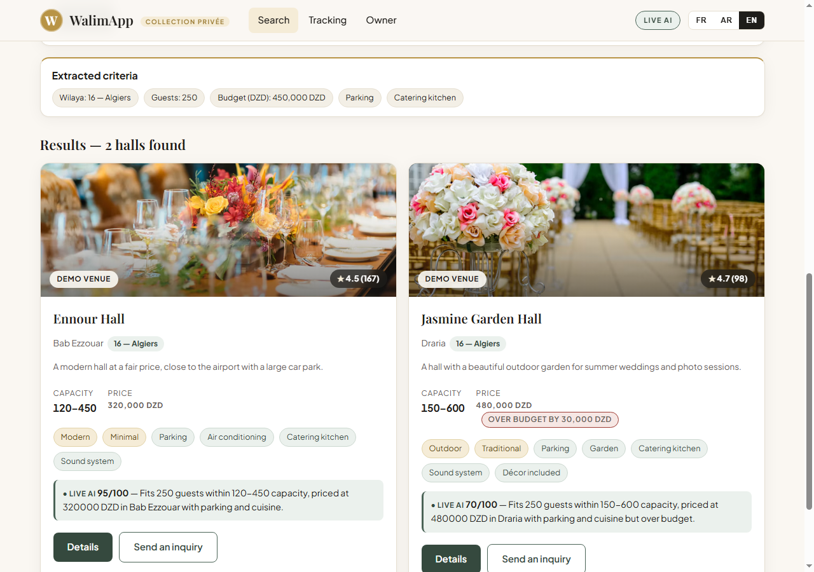

- Landing page with hero imagery and the **Muse Spark Concierge** (free-text box + example chips).
- Filters: **wilaya (all 69)**, commune, event date, guests, budget (whole DZD), style and 8 services (parking, air conditioning, catering kitchen, sound system, decoration, cloakroom, garden, lodging).
- Hall cards with price, capacity, location, amenities, rating pill and a *Demonstration venue* badge.
- Halls priced above the stated budget (the search tolerates up to 125 % of it) are **explicitly marked "Over budget by …"**.
- Trilingual UI: **French / Arabic (RTL) / English**. Responsive from 375 px phones to desktop.

## 4. Venue discovery and booking workflow

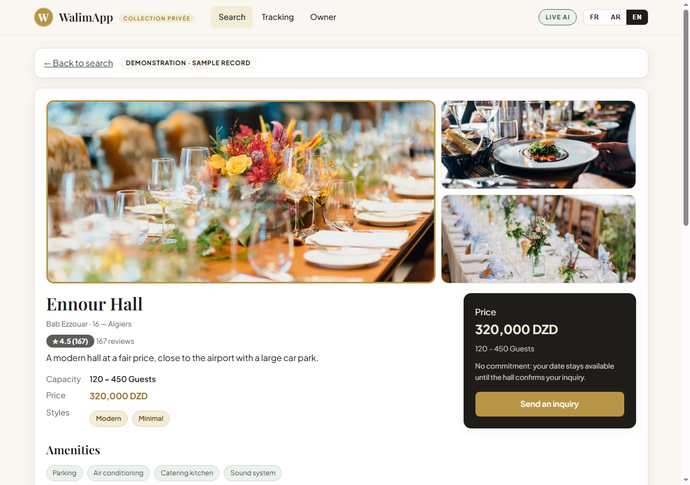
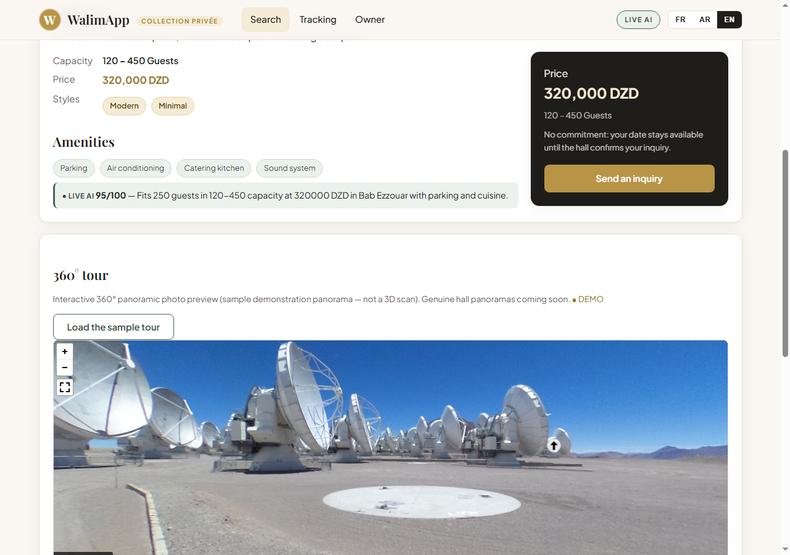

**Discovery pipeline (`POST /api/ai/rank`)**

1. A **deterministic server-side parser** (French/Arabic/English patterns, no LLM) extracts wilaya, commune, date or month, guests, budget, style and amenities from the text. They are shown as *Extracted criteria* chips and back-filled into the filters.
2. The server selects **candidate records from `data/halls.json`** (capacity fit, budget, amenities, wilaya, and availability on the requested date).
3. **Muse Spark (`muse-spark-1.3`)** receives the user's request, the criteria and *only those candidate records*, and returns a JSON ranking with a 0–100 score and a one-sentence reason in the user's language.
4. The server **validates the reply**: unknown hall IDs are dropped, duplicates removed, scores clamped, and any candidate Spark omitted is appended from the deterministic ranking. Prices, capacities and amenities shown on the cards always come from the dataset, never from the model.
5. If the key is missing, Meta is unreachable, returns an error or an unusable reply, the response is `mode: "cached"` with a `fallbackReason`, the badge stays **DEMO**, and the reason text is a deterministic demo ranking — **cached output is never labelled live**.

The 360° viewer uses [Pannellum](https://pannellum.org/) with a **generic sample panorama (an unrelated outdoor placeholder scene, not the hall)** — it demonstrates the viewer only. It is a panoramic photo viewer, **not a 3D scan** of any venue.

**Booking rules**

- An inquiry starts **pending** and does **not** block the date.
- Only an **accepted** inquiry blocks that hall/date. Accepting a second inquiry for the same hall and date returns **HTTP 409** (`date_already_booked`) and the second stays pending until rejected.
- Hall search and discovery exclude halls already confirmed on the requested date.
- Clients track a booking with its reference; the public lookup **never returns the phone number**.
- Inquiries are stored via the dual-mode storage engine (MariaDB when configured, otherwise atomic `data/inquiries.json`, git-ignored).

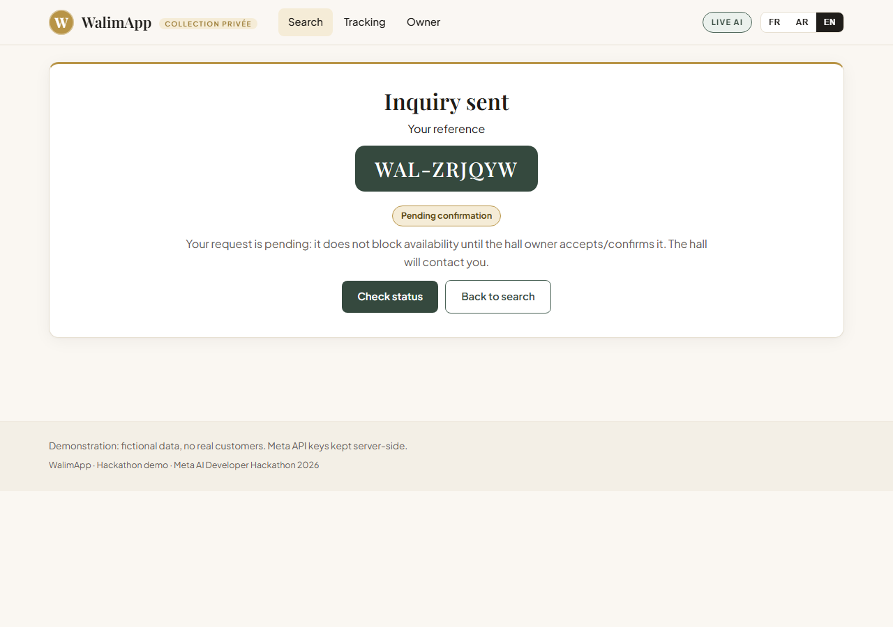

## 5. AI Architecture

- **Genuine live Meta Muse Spark 1.3 natural language ranking and reasoning via `/api/ai/rank`**
  (alias `/api/ai/discover`): the server sends the user's prompt, the extracted criteria, and only the real candidate
  hall records to `muse-spark-1.3`, validates the returned JSON ranking, and renders scores with one-sentence grounded
  reasons in the user's language.
- **Honest DEMO vs LIVE labeling**: the API returns `mode: "live"` only after a successful live Meta response;
  otherwise it returns `mode: "cached"` with a `fallbackReason` and the UI badge stays **DEMO**. Cached output is
  never labelled live. See `GET /api/meta-status` (key-configured flag and model IDs, never the key).
- **WalimApp AI Venue Advisor** (owner-only `POST /api/owner/halls/:id/advisor`): grounded listing advice for hall
  owners. Stored `facts` (wilaya, commune, capacity, price, styles, amenities, photo counts) stay separate from the
  6-section AI `report` (`strengths`, `galleryObservations`, `recommendedViews`, `listingImprovements`,
  `presentationTips`, `nextActions`) written in the owner's language (fr/ar/en). Live reasoning via `muse-spark-1.3`
  when a key is configured, otherwise a deterministic cached demo (`walimapp-venue-advisor-1`) that never invents
  facilities and never guarantees bookings. Covered offline by `tests/advisor.js`.
- **SAM 3.1 and Muse Image are in cached demo mode.** The experimental décor-studio endpoints (`/api/ai/decorate`,
  `/api/ai/segment`, reachable only via `#/studio`) fall back to clearly labelled demo output:
  - `sam-3.1` segmentation: the app's dependency-free parser extracts no reliable regions from the Responses payload,
    so the endpoint returns labelled demo segmentation. Treat SAM 3.1 as **cached demo mode, not integrated**.
  - `muse-image-1.0` decoration concepts: served as **cached demo mode** in this prototype; not part of the
    marketplace or booking journey and not covered by automated tests.

## 6. Customer Accounts & Security

- **Passwords**: hashed with Node's built-in `crypto.scrypt` (random 16-byte salt, 64-byte derived key,
  timing-safe verification via `crypto.timingSafeEqual`). Plain-text passwords are never stored or logged.
  Minimum policy: 8+ characters with at least one letter and one digit.
- **Sessions**: 32-byte hex tokens stored server-side with a 7-day TTL, delivered in an
  **HttpOnly SameSite=Lax session cookie** (`wa_session`, `Secure` flag in production). Logout deletes the
  server-side session and clears the cookie.
- **Rate limiting**: in-memory sliding window on authentication endpoints
  (10 attempts / 60 s per IP+action on register and login; `HTTP 429` with `Retry-After: 60` when exceeded).
- **Customer-isolated booking dashboards**: `GET /api/customer/inquiries` lists only inquiries whose `customerId`
  matches the logged-in user; `GET /api/customer/inquiries/:ref` returns `404` for anyone else's reference.
  Public tracking (`GET /api/inquiries/:ref`) stays privacy-safe and never returns the phone number.
- **Out of scope for this hackathon prototype**: **email verification and password reset are explicitly out of scope**.
  There is no email sending, no verification links, and no reset flow; account recovery is manual (delete/re-register
  in file mode, or update the row in MariaDB mode).

## 7. Owner workspace & Owner Configuration

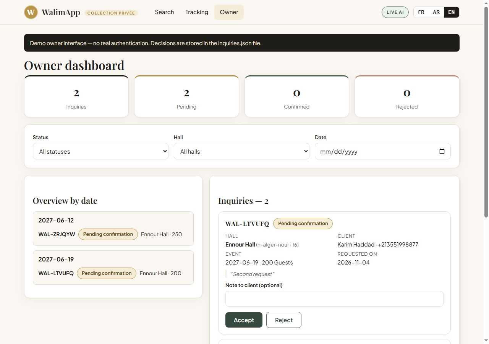
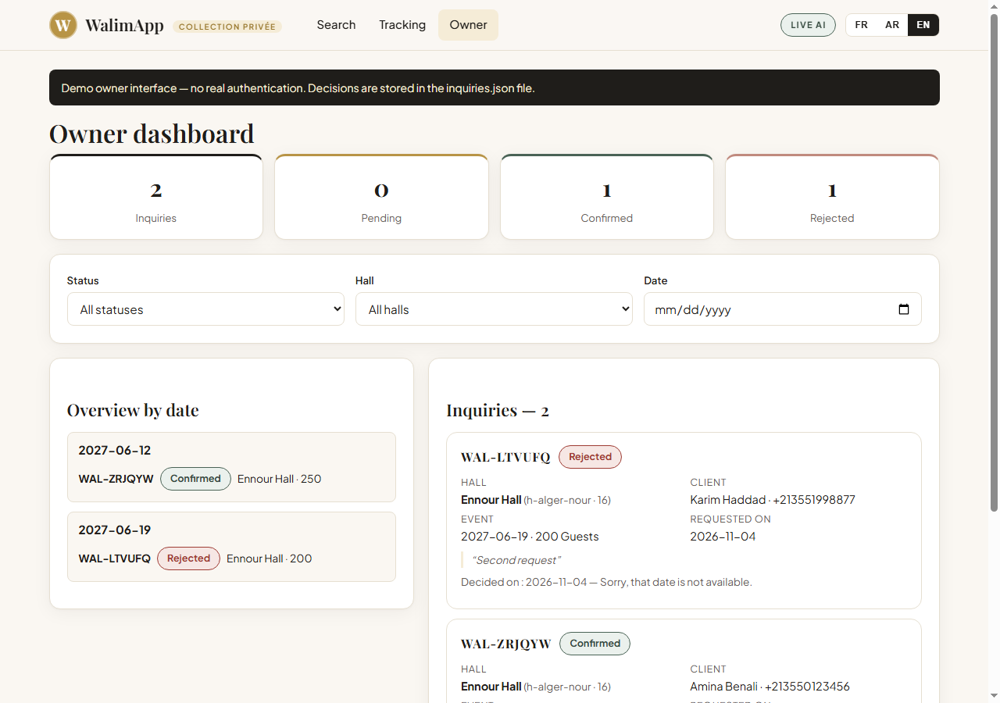

- Summary tiles: total, pending, confirmed, rejected.
- Inbox with client name and phone, hall, event date, guest count, message and request date.
- Filters by status, hall and date; an *overview by date* panel.
- **Accept / Reject** with an optional note to the client; decisions persist across reloads and server restarts.
- The owner API (`GET /api/owner/inquiries`, `POST /api/owner/inquiries/:ref/decision`) requires an authenticated
  session with `role: "owner"` (`401` without login, `403` for customers).

**Configure the demonstration owner account in `.env`** (never commit `.env`; no password is hardcoded in the repo):

```powershell
copy .env.example .env      # macOS/Linux: cp .env.example .env
# then edit .env and set:
# OWNER_EMAIL=owner@example.dz
# OWNER_PASSWORD=<choose-a-strong-demo-password>
```

- At startup (and on owner login) the server syncs `OWNER_EMAIL` / `OWNER_PASSWORD` into storage as the `owner` user
  (`lib/auth.js` `ensureOwnerUser()`); changing `OWNER_PASSWORD` in `.env` updates the stored hash on next start/login.
- `GET /api/auth/owner-status` reports only whether both variables are configured (never their values).
- If `OWNER_EMAIL` / `OWNER_PASSWORD` are unset, the owner workspace shows a "not configured" state and owner login fails.

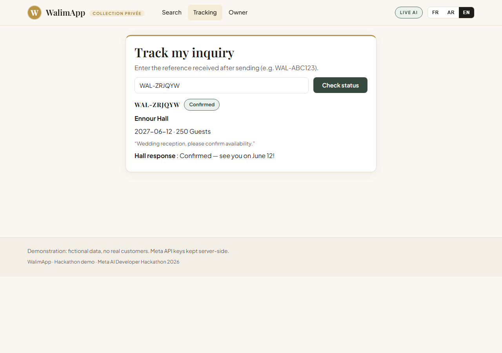

<p>
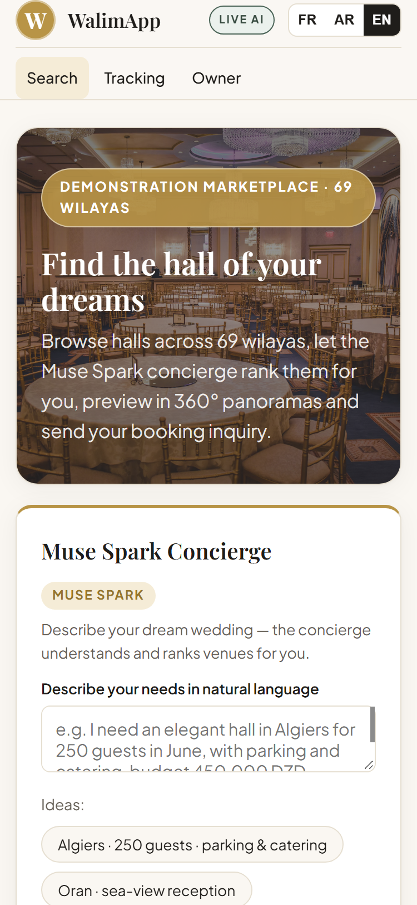
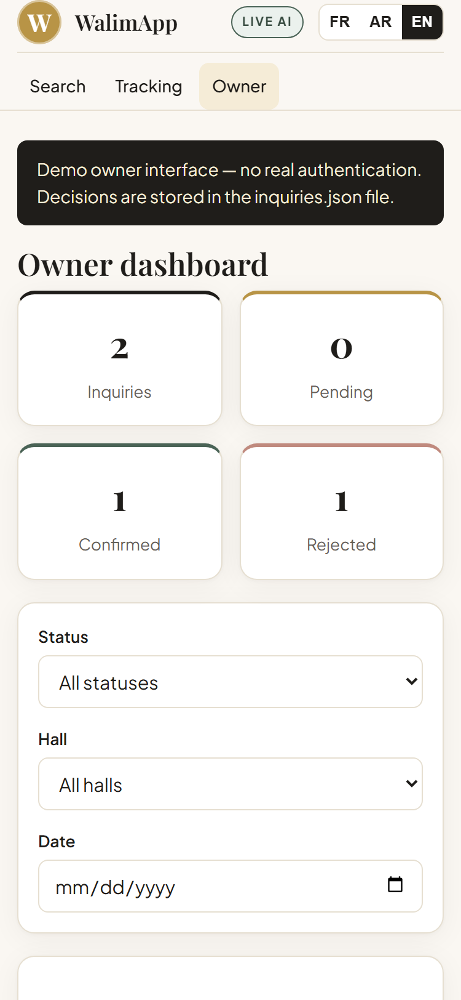
</p>

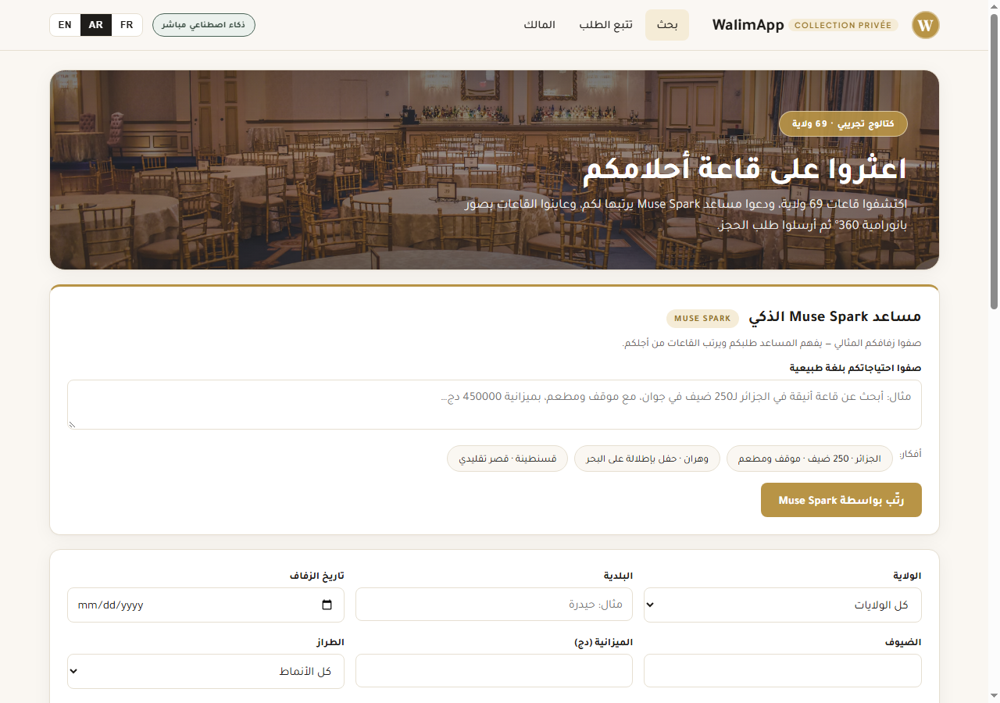

## 8. Technology and architecture

- **Node.js ≥ 22, zero required npm dependencies** (built-in `http`, `fs`, `crypto`, global `fetch`). No build step.
  `mysql2` is an optional dependency used only when MariaDB is configured.
- `server.js` — HTTP server, REST API, validation, booking state machine, dual-mode persistence, static files. All `/api/*` responses carry `Cache-Control: no-store`.
- `lib/meta.js` — server-side Meta Model API client (timeouts, error mapping, one secret-safe log line per call).
- `lib/auth.js` — `crypto.scrypt` passwords, session cookies, rate limiting, owner sync.
- `lib/storage.js` — dual-mode storage engine (MariaDB via `mysql2/promise` with transparent fallback to atomic JSON files).
- `lib/migrate.js` + `lib/schema.sql` — MariaDB schema + seed runner (`npm run migrate`).
- `public/` — vanilla JS single-page app (`index.html`, `app.js`, `styles.css`), hash routing, fr/ar/en i18n.
- `data/` — `halls.json` (14 fictional sample halls), `wilayas.json` (69 wilayas); runtime files `inquiries.json`, `users.json`, `sessions.json` (git-ignored).
- External resources loaded by the browser: Google Fonts, the Pannellum library and sample panoramas, and Unsplash stock photos used as placeholder imagery (the pages fall back gracefully if offline, except the 360° viewer).
- The API key lives **only on the server**; the browser never receives it.

```
Browser (SPA) ──► server.js ──► lib/storage.js ──► MariaDB (mysql2) or data/*.json
                     │
                     └──► lib/meta.js ──► https://api.meta.ai/v1/chat/completions  (Muse Spark)
```

### MariaDB Dual-Storage & Migration

The **dual-mode storage engine** (`lib/storage.js`) uses **MariaDB with `mysql2`** when `DB_HOST`/`DB_USER`/`DB_NAME`
are configured **and** a connection succeeds; otherwise it transparently falls back to an **atomic JSON file fallback**
in `data/` (`users.json`, `sessions.json`, `inquiries.json`, written via temp file + rename behind a serialized write
queue so concurrent read-modify-write cycles cannot interleave). A mid-run connection failure degrades the current
operation to file mode.

Apply the schema and seed the database with **`npm run migrate`** (`node lib/migrate.js`):

- Creates tables from `lib/schema.sql` (`users`, `sessions`, `inquiries`).
- Seeds `inquiries` from `data/inquiries.json` when the table is empty; skips seeding when rows already exist.
- Exits 0 with an informational message when MariaDB is not configured, `mysql2` is missing, or the database is
  unreachable (the server then runs in JSON file mode).

## 9. Install and run

Requirements: **Node.js 22 or newer**.

```powershell
git clone <repository-url>
cd <repository-folder>
copy .env.example .env      # macOS/Linux: cp .env.example .env
# edit .env and set MODEL_API_KEY (optional — see below) and OWNER_EMAIL / OWNER_PASSWORD for the owner demo
npm start
```

Open **http://localhost:3000**. The terminal prints whether a key is configured and, for every Meta call, one line such as
`[meta] POST /chat/completions model=muse-spark-1.3 -> HTTP 200 in 6090ms` (no keys, prompts or bodies are ever logged).

**Without a key** the whole app works in clearly labelled **cached demo mode** (badge: DEMO). With a key, discovery is live.

Optional MariaDB path:

```powershell
npm install mysql2
# set DB_HOST, DB_NAME, DB_USER, DB_PASSWORD in .env (see below)
npm run migrate
npm start
```

Run the tests (fully offline, no key needed, they never touch your `.env`):

```powershell
npm test
```

## 10. Environment variables

Copy `.env.example` to `.env` (git-ignored). **Never commit `.env`.**

| Variable | Required | Meaning |
|---|---|---|
| `MODEL_API_KEY` | for live AI | Meta Model API key, read server-side only (`META_API_KEY` is accepted as an alias) |
| `OWNER_EMAIL` | for owner demo | Demo owner login email (synced into storage at startup) |
| `OWNER_PASSWORD` | for owner demo | Demo owner login password (synced into storage at startup; never hardcoded) |
| `DB_HOST` | for MariaDB mode | MariaDB host (without `DB_HOST`/`DB_USER`/`DB_NAME` the server uses atomic JSON files) |
| `DB_NAME` | for MariaDB mode | MariaDB database name |
| `DB_USER` | for MariaDB mode | MariaDB user |
| `DB_PASSWORD` | for MariaDB mode | MariaDB password |
| `DB_PORT` | no | MariaDB port, default `3306` |
| `PORT` | no | HTTP port, default `3000` (on cPanel, Phusion Passenger injects `process.env.PORT` — see below) |
| `META_API_BASE` | no | Default `https://api.meta.ai/v1` |
| `META_SPARK_MODEL` | no | Default `muse-spark-1.3` |
| `META_SAM_MODEL` | no | Default `sam-3.1` (cached demo mode) |
| `META_IMAGE_MODEL` | no | Default `muse-image-1.0` (cached demo mode) |

## 11. Namecheap Stellar cPanel Deployment Guide

Target: **Namecheap Stellar** shared hosting with cPanel's **"Setup Node.js App"** and **Node 22.x**.

1. **Prerequisites**: in cPanel open **"Setup Node.js App"**, choose **Node 22.x**, and create the application.
   Note the assigned port; you do not hardcode it (see step 6).
2. **Application root**: `/home/<user>/walimapp` — deploy the app **outside `public_html`**
   (replace `<user>` with your cPanel username). Upload the project files there (excluding `node_modules/`, `.env`,
   and `data/*.json` runtime files), then run `npm install mysql2` in that directory only if you use MariaDB.
3. **Application URL**: point your **domain/subdomain** to the Node.js app in "Setup Node.js App"
   (cPanel wires the domain to the app via Phusion Passenger; no `.htaccess` proxy is needed).
4. **Startup file**: `server.js` (Application startup file in the cPanel form).
5. **Environment variables** (cPanel "Environment variables" section — never commit these to git):
   `MODEL_API_KEY`, `OWNER_EMAIL`, `OWNER_PASSWORD`, `DB_HOST`, `DB_NAME`, `DB_USER`, `DB_PASSWORD`.
   Set `DB_*` only when using the cPanel MariaDB database you created for this app; otherwise leave them unset and
   the app runs on its atomic JSON file fallback. After saving, run `npm run migrate` once from the application root
   (via cPanel Terminal or SSH) when using MariaDB.
6. **`process.env.PORT` handling by Phusion Passenger**: cPanel/Phusion Passenger injects the assigned port as the
   `PORT` environment variable and routes the domain to it. The server reads `Number(process.env.PORT || 3000)` and
   calls `server.listen(PORT)`, so it binds to the Passenger-assigned port automatically with a local default of 3000.
   Do not hardcode a port and do not set `PORT` manually in cPanel.
7. Restart the app from "Setup Node.js App" after each deploy or environment change, then open the domain and check
   `GET /api/health` and `GET /api/meta-status`.

## 12. Sample and demo data

- The 14 halls in `data/halls.json` are **invented for this demonstration**. Names, communes, prices, capacities, ratings and amenities do **not** describe real businesses.
- Photos are generic stock images (Unsplash) and are **not photographs of these venues**; the 360° view is a sample panorama.
- Ratings are sample values. Inquiries created while testing are fictional. Phone numbers in screenshots are made up.
- Seed state: `data/inquiries.json` ships with 2 demonstration inquiries (`WAL-HV88RQ`, `WAL-Y3N0XQ`);
  `data/users.json` and `data/sessions.json` are runtime files (`[]` when empty) and are git-ignored, as are
  `data/*.tmp` temp files and `*.log` files.

## 13. Security limitations of this prototype

This is a hackathon demo, **not production-ready**:

- Owner endpoints require an authenticated `owner` session, and customer endpoints are customer-isolated, but there is
  no CSRF token (only `SameSite=Lax`), no HTTPS termination in-app (rely on cPanel TLS), and no bot protection.
- In JSON file mode, inquiries (including names and phone numbers) are stored **unencrypted** in a local JSON file with
  no backup. Prefer MariaDB mode for anything beyond the demo.
- **Email verification and password reset are out of scope** (see §6). Sessions expire after 7 days; there is no
  forced rotation or device management.
- The free-text wedding request (max 1000 characters) and the candidate hall records are sent to the Meta Model API when a key is configured; no contact details or inquiry data are sent.
- The client tracking reference is the only secret protecting a guest booking status (logged-in customers additionally
  have session-protected `My bookings`).
- Consent is a checkbox only; there is no data-retention or deletion workflow.

## 14. API and model documentation

### Meta models

| Model | Endpoint | Invoked by | What it does | Status |
|---|---|---|---|---|
| **`muse-spark-1.3`** | `POST https://api.meta.ai/v1/chat/completions` | Concierge → **Rank with Muse Spark** (`POST /api/ai/rank`, alias `/api/ai/discover`) | Ranks the real candidate halls for the couple's request and writes a grounded one-sentence reason per hall in fr/ar/en | **Integrated and tested live.** Live HTTP 200 from Meta, grounded results checked against `data/halls.json`, UI shows LIVE AI only after success. The request/validation/fallback logic is also covered offline by `tests/meta-mock.js` (mock Meta server, no real key). |
| **`muse-spark-1.3`** (advisor) | `POST https://api.meta.ai/v1/chat/completions` | Owner advisor (`POST /api/owner/halls/:id/advisor`) | Writes the grounded 6-section WalimApp AI Venue Advisor report in fr/ar/en from stored hall facts | **Live when configured, otherwise deterministic cached demo** (`walimapp-venue-advisor-1`; never invents facilities or guarantees bookings). Covered offline by `tests/advisor.js`. |
| `sam-3.1` | `POST https://api.meta.ai/v1/responses` | Experimental décor studio (`/api/ai/segment`, `#/studio` only) | Hall-photo segmentation | **Cached demo mode** — parser extracts no regions; labelled demo output only. |
| `muse-image-1.0` | `POST https://api.meta.ai/v1/images/generations` | Experimental décor studio (`/api/ai/decorate`, `#/studio` only) | Décor concept images | **Cached demo mode** — not part of the marketplace journey, no automated tests. |

No other Meta model is called anywhere in the code.

### REST endpoints

| Method & path | Purpose |
|---|---|
| `GET /api/health`, `GET /api/meta-status` | Health; key-configured flag and model IDs (never the key) |
| `GET /api/wilayas` | The 69 wilayas |
| `GET /api/halls/search?wilaya=&commune=&date=&guests=&budget=&style=&amenities=a,b` | Filter halls |
| `GET /api/halls/:id` | One hall |
| `POST /api/ai/rank` `{prompt, lang, criteria?}` | Natural-language discovery. Returns `mode: "live" \| "cached"`, `model`, `extractedCriteria`, `ranking[]`, `halls[]`, and `fallbackReason` when cached |
| `POST /api/auth/register` `{fullName, email, password, confirmPassword}` | Customer registration (rate-limited, sets session cookie) |
| `POST /api/auth/login` `{email, password}` | Customer or owner login (rate-limited, sets session cookie) |
| `POST /api/auth/logout` | Logout (deletes session, clears cookie) |
| `GET /api/auth/me` | Current session user |
| `GET /api/auth/owner-status` | Whether `OWNER_EMAIL`/`OWNER_PASSWORD` are configured (no values) |
| `POST /api/inquiries` | Create a pending inquiry (consent required, linked to customer when logged in). Returns a `WAL-XXXXXX` reference |
| `GET /api/inquiries/:ref` | Privacy-safe status lookup for the client (no phone number) |
| `GET /api/customer/inquiries` | Logged-in customer's own inquiries with counts (customer-isolated) |
| `GET /api/customer/inquiries/:ref` | One own inquiry (`404` for anyone else's) |
| `POST /api/auth/register-owner` `{fullName, email, password, confirmPassword, businessName, phone, wilaya, commune, businessDescription?}` | Dedicated owner registration (`status: pending`, requires admin approval) |
| `GET /api/owner/halls`, `POST /api/owner/halls` | List owner's halls or create a new hall (**requires approved owner session**) |
| `PUT /api/owner/halls/:id`, `DELETE /api/owner/halls/:id` | Update or delete a hall owned by the caller (ownership-isolated) |
| `POST /api/owner/halls/:id/photos`, `DELETE /api/owner/halls/:id/photos` | Upload (multipart/form-data) or delete hall gallery photos |
| `POST /api/owner/halls/:id/scenes` | Upload 360° panorama image (equirectangular 2:1 validation) and add tour scene |
| `PUT /api/owner/halls/:id/scenes`, `DELETE /api/owner/halls/:id/scenes/:sceneId` | Update scene hotspots/title or remove a tour scene |
| `POST /api/owner/halls/:id/advisor` `{selectedPhotos?, lang?}` | WalimApp AI Venue Advisor: owner-only grounded listing report (`facts` + 6-section `report`, `mode: "live" \| "cached"`) |
| `GET /api/owner/inquiries?status=&hallId=&date=` | Owner inbox with counts (**requires authenticated owner session**, isolated to own halls) |
| `POST /api/owner/inquiries/:ref/decision` `{decision: "accept" \| "reject", note}` | Decide a pending inquiry; `409` on repeat or when the date is already confirmed |
| `GET /api/admin/metrics` | Super Admin platform overview metrics (owners, halls, inquiries) |
| `GET /api/admin/owners` | List all registered hall owners with approval status |
| `POST /api/admin/owners/:id/status` `{status: "approved" \| "rejected" \| "suspended"}` | Super Admin moderation action on hall owner account |

## 15. Verification performed

- `npm test` — eight offline suites (270 assertions, zero external dependencies):
  - API smoke tests (`tests/smoke.js`)
  - Booking lifecycle and double-booking conflict prevention (`tests/booking.js`)
  - Meta Model API integration and fallback handling (`tests/meta-mock.js`)
  - Customer and owner authentication and session management (`tests/auth.js`)
  - Owner hall CRUD and photo gallery management (`tests/halls.js`)
  - WalimApp AI Venue Advisor listing recommendations (`tests/advisor.js`)
  - Connected multi-scene 360° virtual tours (`tests/tour.js`)
  - Multi-owner isolation and Super Admin moderation (`tests/multi-owner.js`)
- Manual/automated browser verification in Chrome at 375 px, 640 px and 1280 px in English and Arabic: marketplace, live Muse Spark discovery, venue detail, 360° viewer, booking, customer accounts, owner accept/reject, client tracking, Super Admin owner approval, and multi-owner isolation.
- The screenshots in `docs/screenshots/` were captured from that real running application with a live Muse Spark call.

## 16. How this was built

Developed with **Muse Code** as the implementation agent under human/agent technical review.
The three-minute demo plan is in [`docs/DEMO-SCRIPT.md`](docs/DEMO-SCRIPT.md).
