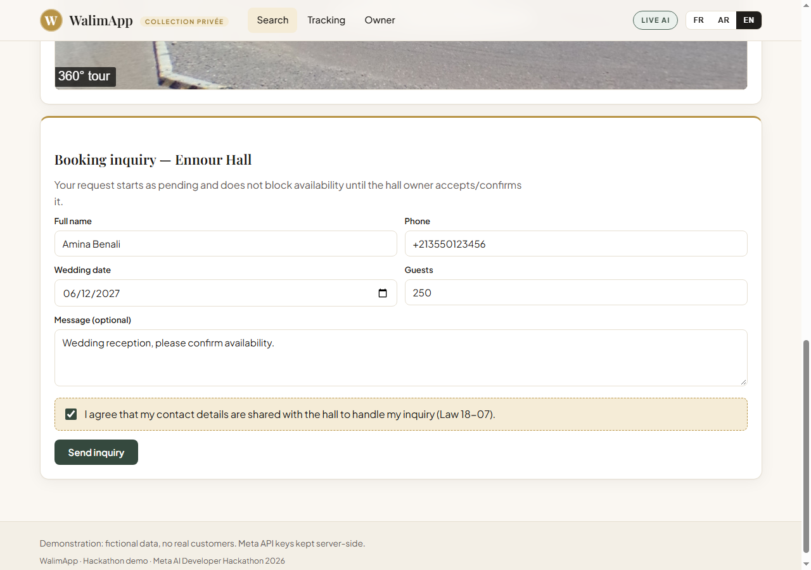

# WalimApp AI — Algerian wedding-hall marketplace with Meta Muse Spark


%20%7C%20EN-orange)

> [!NOTE]
> **Hackathon prototype — Meta AI Developer Hackathon.** WalimApp AI is a responsive **web application** (not a native
> mobile app) that lets couples describe their wedding in plain language, get venue recommendations from
> **Meta Muse Spark 1.3** grounded in real catalogue records, explore halls in interactive 360° virtual tours, and send
> booking inquiries that hall owners triage from an operational dashboard.
>
> **All venues are fictional sample records.** No real hall, price, availability, person, or booking is represented.
> Sample photos and panoramas are demonstration placeholders (see §4).


**Contents:** [1. Product Overview & Target Audiences](#1-product-overview--target-audiences) ·
[2. Main User Journeys](#2-main-user-journeys) · [3. Implemented Features](#3-implemented-features) ·
[4. 360° Virtual Tours & Panorama Architecture](#4-360-virtual-tours--panorama-architecture) ·
[5. AI Architecture & Meta Models](#5-ai-architecture--meta-models) ·
[6. Customer Accounts & Multi-Owner Security](#6-customer-accounts--multi-owner-security) ·
[7. Technology, Dual-Mode Storage & Architecture](#7-technology-dual-mode-storage--architecture) ·
[8. Installation and Run Instructions](#8-installation-and-run-instructions) ·
[9. Environment Variables & Account Provisioning](#9-environment-variables--account-provisioning) ·
[10. Namecheap Stellar cPanel Deployment Guide](#10-namecheap-stellar-cpanel-deployment-guide) ·
[11. REST API & Endpoint Reference](#11-rest-api--endpoint-reference) ·
[12. Verification Performed](#12-verification-performed) ·
[13. How This Was Built & Demo Script](#13-how-this-was-built--demo-script)

---

## 1. Product Overview & Target Audiences

WalimApp AI is a **trilingual (FR/AR/EN) discovery marketplace for Algerian wedding venues**, combining AI-powered
natural-language ranking, interactive 360° virtual tours, customer booking tracking, and an owner triage workflow —
responsive from 375 px phones to desktop, with full Arabic right-to-left (RTL) layouts.

The platform serves **three distinct user roles**:

### Couples & Guests (no account required to book)

- **Natural-language search** in French, Arabic, or English ("*elegant hall in Algiers for 250 guests with parking*").
- **Live Muse Spark recommendations**: ranked halls with grounded 0–100 scores and one-sentence explanations.
- **Interactive 360° virtual tours** with multi-scene hotspot navigation on venue pages.
- **Guest booking without mandatory registration**: send an inquiry with explicit privacy consent and receive a
  tracking reference such as `WAL-XXXXXX`.
- **Reference tracking**: follow *Pending → Confirmed / Rejected* plus the owner's note, without exposing phone numbers.

### Wedding Hall Owners (authenticated operational workspace)

- **Authenticated owner workspace** (`#/owner`) with summary tiles, inbox filters, and an overview-by-date panel.
- **Hall CRUD**: create, update, and delete venue listings (`/api/owner/halls`).
- **Photo gallery uploads**: secure multipart image upload and deletion per hall.
- **2:1 equirectangular multi-scene 360° tour builder** with interactive hotspots linking scenes.
- **Booking triage with conflict prevention**: accept/reject inquiries with an optional client note; one confirmed
  booking per hall/date (HTTP 409 on conflict).
- **AI Venue Advisor**: a grounded 6-section listing analysis report for each hall.

### Platform Administrators — Super Admin (`#/admin`)

- **Platform moderation workspace**: review hall-owner applications and moderate accounts.
- **Owner application review**: approve, reject, or suspend owners (`approved`, `rejected`, `suspended`).
  Only approved owners can manage halls; suspended/rejected owners' halls are hidden from public discovery.
- **Platform health metrics**: high-level overview of owners, halls, and inquiries.

---

## 2. Main User Journeys

### Couple's journey — describe → rank → tour → book → track

1. **Describe** the wedding in natural language (French, Arabic, or English), e.g.
   *"I need an elegant wedding hall in Algiers for 250 guests, with parking and catering, and a budget of 450,000 DZD."*
   Example chips help first-time visitors phrase a request.
2. **Muse Spark ranks** the matching halls and explains each match with a score and a grounded reason. The header badge
   shows **LIVE AI** only after a successful live Meta response; otherwise it stays **DEMO** (see §5).
   Extracted criteria chips are shown and back-filled into the search filters.
3. **Tour** the shortlisted halls: photo gallery, capacity, price, amenities — then step into the **360° virtual tour**
   and hop between scenes via interactive hotspots.
4. **Book** by sending an inquiry (name, phone, date, guests, message, explicit privacy consent) and receiving a
   reference such as `WAL-ABC123`. Guests can book freely; logged-in customers also see the inquiry in `My bookings`
   (`#/account`).
5. **Track** the reference at any time (or in `My bookings`) and see *Pending → Confirmed / Rejected* with the owner's
   note. The public lookup never returns the phone number.





### Owner & admin journey — apply → approve → manage halls → triage inquiries → run AI Venue Advisor

1. **Apply**: a new hall owner registers at `#/owner/register` (business name, phone, wilaya, commune, description).
   The account is created with `status: pending` and cannot manage halls yet.
2. **Approve**: the Super Admin reviews the application at `#/admin` and sets `approved`, `rejected`, or `suspended`.
   Approval unlocks the owner workspace; suspension/rejection hides the owner's halls from public discovery.
3. **Manage halls**: the approved owner creates listings (name, wilaya, commune, capacity, price, styles, amenities),
   uploads gallery photos, and builds a connected multi-scene 360° tour from equirectangular panoramas.
4. **Triage inquiries**: the owner works the inbox (status/hall/date filters, summary tiles), then **accepts or rejects**
   each request with an optional note. Accepting a second inquiry for the same hall/date returns **HTTP 409**
   (`date_already_booked`); hall search excludes dates already confirmed.
5. **Run AI Venue Advisor**: per hall, the owner generates a grounded 6-section listing report (strengths, gallery
   observations, recommended views, listing improvements, presentation tips, next actions) in fr/ar/en.


---

## 3. Implemented Features

- [x] **Trilingual FR / AR (RTL) / EN support** with responsive layouts from 375 px mobile to desktop.
- [x] **69 Wilayas of Algeria catalog** with commune, event-date, guest-count, budget, style, and amenity filters
      (8 services: parking, air conditioning, catering kitchen, sound system, decoration, cloakroom, garden, lodging).
      Halls priced above the stated budget (search tolerates up to 125 % of it) are explicitly marked
      *"Over budget by …"*.
- [x] **Natural-Language Discovery (`POST /api/ai/rank`)**: deterministic FR/AR/EN parser extracts wilaya, commune,
      date/month, guests, budget, style, and amenities (no LLM), then **Meta Muse Spark 1.3** ranks candidates from
      `data/halls.json` with grounded scores and reasons.
- [x] **Interactive 360° Virtual Tours**: multi-scene equirectangular panoramas with interactive hotspot navigation
      (Pannellum viewer).
- [x] **Guest Inquiries & Tracking**: booking reference generation (e.g. `WAL-XXXXXX`); privacy-safe tracking that
      never exposes phone numbers.
- [x] **Customer Accounts**: `crypto.scrypt` password hashing, HttpOnly session cookies, personal dashboard
      (`#/account` → `My bookings`).
- [x] **Multiple Independent Owners**: strict isolation — each owner sees and edits only their own halls, photo
      galleries, tour scenes, and customer inquiries (cross-owner access returns 403/404).
- [x] **Dedicated Owner Registration & Super Admin Approval**: `#/owner/register` creates `status: pending`;
      review and approval happen at `#/admin`.
- [x] **Super Admin Platform Workspace**: overview metrics plus owner moderation
      (`approved`, `rejected`, `suspended`).
- [x] **Owner Hall Management**: full CRUD (`GET/POST/PUT/DELETE /api/owner/halls…`, approved owners only).
- [x] **Secure Photo Gallery Uploads**: multipart image upload and deletion (`/api/owner/halls/:id/photos`).
- [x] **Connected Multi-Scene 360° Tour Builder**: panorama upload with 2:1 aspect-ratio validation
      (`POST /api/owner/halls/:id/panoramas`), hotspot coordinate mapping and scene wiring
      (`PUT /api/owner/halls/:id/tour`), scene deletion.
- [x] **WalimApp AI Venue Advisor** (`POST /api/owner/halls/:id/advisor`): grounded listing analysis generated by
      `muse-spark-1.3` (or a deterministic cached fallback) with 6 structured sections; stored facts stay separate
      from the AI report, which never invents facilities and never guarantees bookings.
- [x] **Booking Conflict Protection**: double-booking prevention — one confirmed booking per hall/date with HTTP 409.
      Pending inquiries never block a date; only accepted ones do.

<p>


</p>


---

## 4. 360° Virtual Tours & Panorama Architecture


- **Equirectangular format**: panoramas must be spherical equirectangular images with a **2:1 aspect ratio**
  (e.g. 4096×2048). The server enforces ratio validation on upload (`POST /api/owner/halls/:id/panoramas` rejects
  non-conforming images with a clear error); `tests/tour.js` covers acceptance and rejection.
- **Multi-scene linking**: owners wire scenes together with **interactive hotspots carrying yaw/pitch coordinates**
  that jump the viewer from one scene to another (`PUT /api/owner/halls/:id/tour`, max 20 hotspots per scene,
  hotspot targets validated against known scene IDs).
- **Photos vs panoramas**: standard photos are regular 2D gallery stills shown in the gallery carousel; panoramas are
  equirectangular projection assets used **exclusively** in the 360° viewer. The two pipelines (gallery vs tour) are
  separate on both client and server.
- **Limitations**: the viewer renders **panoramic photo spheres via Pannellum — NOT dense 3D polygon meshes or
  Matterport-style LiDAR scans**. There is no geometry reconstruction, depth sensing, or dollhouse view.

> [!IMPORTANT]
> **Attribution & licensing.** The 360° viewer is [Pannellum](https://pannellum.org/) (MIT License, © Matthew Petroff),
> loaded from CDN. The demonstration sample panoramas come from the official Pannellum documentation gallery
> (`pannellum.org/images/…`) and the demonstration venue photography is generic stock imagery from Unsplash.
> All of it is **fictional demonstration content** — none of it depicts the listed venues, which are invented records.

---

## 5. AI Architecture & Meta Models

### Natural-language discovery (`POST /api/ai/rank`, alias `/api/ai/discover`)

1. A **deterministic server-side parser** (French/Arabic/English patterns, no LLM) extracts wilaya, commune, date or
   month, guests, budget, style, and amenities. They are shown as *Extracted criteria* chips and back-filled into
   the filters.
2. The server selects **candidate records from `data/halls.json`** (capacity fit, budget tolerance, amenities, wilaya,
   and availability on the requested date; halls of non-approved owners are excluded).
3. **Muse Spark (`muse-spark-1.3`)** receives the user's request, the criteria, and *only those candidate records*,
   and returns a JSON ranking with a 0–100 score and a one-sentence reason in the user's language.
4. The server **validates the reply**: unknown hall IDs are dropped, duplicates removed, scores clamped, and any
   candidate Spark omitted is appended from the deterministic ranking. Prices, capacities, and amenities on the cards
   always come from the dataset, never from the model.
5. If the key is missing, Meta is unreachable, returns an error, or returns an unusable reply, the response is
   `mode: "cached"` with a `fallbackReason`, the badge stays **DEMO**, and the ranking is a deterministic demo
   ordering.

### AI Venue Advisor (`POST /api/owner/halls/:id/advisor`, owner-only)

Grounded listing advice: stored `facts` (wilaya, commune, capacity, price, styles, amenities, photo/tour counts) stay
separate from the 6-section AI `report` (`strengths`, `galleryObservations`, `recommendedViews`, `listingImprovements`,
`presentationTips`, `nextActions`) written in the owner's language (fr/ar/en). Live reasoning via `muse-spark-1.3`
when a key is configured, otherwise a deterministic cached demo (`walimapp-venue-advisor-1`). Covered offline by
`tests/advisor.js`.

### Configuration & honesty guarantees

- The API key is configured **server-side only via `MODEL_API_KEY`** (`META_API_KEY` accepted as an alias). **The
  browser never sees keys** — see `GET /api/meta-status`, which exposes only a key-configured flag and model IDs.
- **Honest LIVE vs DEMO labeling**: the app returns `mode: "live"` **only** when Meta returns HTTP 200 with a usable
  payload; otherwise it returns `mode: "cached"` with a `fallbackReason`. **Cached output is NEVER falsely
  labelled live** — the UI badge flips to LIVE AI only after a confirmed live response.
- **Honest model scope**: `sam-3.1` (décor segmentation) and `muse-image-1.0` (décor concepts), reachable only via the
  experimental `#/studio` page (`/api/ai/segment`, `/api/ai/decorate`), are **experimental cached demos, not
  integrated into the main marketplace journey** and not covered by automated tests.

| Model | Invoked by | What it does | Status |
|---|---|---|---|
| **`muse-spark-1.3`** | Concierge → **Rank with Muse Spark** (`POST /api/ai/rank`) | Ranks real candidate halls with grounded 0–100 scores and one-sentence reasons in fr/ar/en | **Integrated and tested live** (HTTP 200 from Meta, results validated against `data/halls.json`; offline fallback logic covered by `tests/meta-mock.js`) |
| **`muse-spark-1.3`** (advisor) | Owner advisor (`POST /api/owner/halls/:id/advisor`) | Writes the grounded 6-section Venue Advisor report in fr/ar/en | **Live when configured, otherwise deterministic cached demo** (`walimapp-venue-advisor-1`); covered offline by `tests/advisor.js` |
| `sam-3.1` | Experimental décor studio (`/api/ai/segment`, `#/studio` only) | Hall-photo segmentation | **Cached demo mode** — labelled demo output only, not integrated |
| `muse-image-1.0` | Experimental décor studio (`/api/ai/decorate`, `#/studio` only) | Décor concept images | **Cached demo mode** — not part of the marketplace journey, no automated tests |

No other Meta model is called anywhere in the code. One secret-safe log line per Meta call
(e.g. `[meta] POST /chat/completions model=muse-spark-1.3 -> HTTP 200 in 6090ms`); keys, prompts, and bodies are
never logged, and no contact or inquiry data is ever sent to Meta.

---

## 6. Customer Accounts & Multi-Owner Security

- **Passwords hashed with `crypto.scrypt`** (random 16-byte salt, 64-byte derived key, timing-safe verification via
  `crypto.timingSafeEqual`). Plain-text passwords are never stored or logged. Minimum policy: 8+ characters with at
  least one letter and one digit.
- **HttpOnly SameSite=Lax session cookies** (`wa_session`, `Secure` flag in production) with a **7-day TTL**;
  32-byte hex tokens stored server-side. Logout deletes the server-side session and clears the cookie.
- **In-memory rate limiting on auth endpoints**: 10 attempts / 60 s per IP+action on register and login
  (`HTTP 429` with `Retry-After: 60` when exceeded).
- **Customer-isolated dashboards**: `GET /api/customer/inquiries` lists only inquiries whose `customerId` matches the
  logged-in user; `GET /api/customer/inquiries/:ref` returns `404` for anyone else's reference. Public tracking
  (`GET /api/inquiries/:ref`) stays privacy-safe and never returns the phone number.
- **Owner isolation**: owners strictly access only their own halls, galleries, tour scenes, and inquiries —
  cross-owner reads/writes are rejected (403/404), and public discovery hides halls of non-approved owners.
  Covered by `tests/multi-owner.js` and `tests/halls.js`.
- **Server-side authorization checks on all protected endpoints**: customer routes require a customer session (401
  anonymous), owner routes require an **approved** owner session (401/403), admin routes require a `super_admin`
  session (401/403). All `/api/*` responses carry `Cache-Control: no-store`.
- **Disclosure**: **email addresses are not verified in this prototype** — there is no email sending, no verification
  links, and no password-reset flow; account recovery is manual (delete/re-register in file mode, or update the row
  in MariaDB mode).

> [!WARNING]
> **Security limitations of this prototype (not production-ready):** no CSRF token (only `SameSite=Lax`), no HTTPS
> termination in-app (rely on cPanel TLS), no bot protection, and no data-retention/deletion workflow. In JSON file
> mode, inquiries (including names and phone numbers) are stored **unencrypted** in a local git-ignored JSON file with
> no backup — prefer MariaDB mode beyond the demo. The tracking reference is the only secret protecting a guest
> booking status (logged-in customers additionally have session-protected `My bookings`).

---

## 7. Technology, Dual-Mode Storage & Architecture

- **Node.js ≥ 22, zero required external dependencies** — uses Node built-ins only (`http`, `fs`, `crypto`, global
  `fetch`). No build step. `mysql2` is an optional dependency used only when MariaDB is configured.
- `server.js` — HTTP server, REST API, validation, booking state machine, dual-mode persistence, static files.
- `lib/meta.js` — server-side Meta Model API client (timeouts, error mapping, one secret-safe log line per call).
- `lib/auth.js` — `crypto.scrypt` passwords, session cookies, rate limiting, owner/admin provisioning sync.
- `lib/storage.js` — dual-mode storage engine (MariaDB via `mysql2/promise`, transparent fallback to atomic JSON).
- `lib/migrate.js` + `lib/schema.sql` — MariaDB schema + seed runner (`npm run migrate`).
- `public/` — vanilla JS single-page app (`index.html`, `app.js`, `styles.css`), hash routing, fr/ar/en i18n.
- `data/` — `halls.json` (14 fictional sample halls), `wilayas.json` (69 wilayas); runtime files `inquiries.json`,
  `users.json`, `sessions.json` (git-ignored).
- External resources loaded by the browser: Google Fonts, the Pannellum library/sample panoramas, and Unsplash stock
  placeholder imagery (pages degrade gracefully offline, except the 360° viewer).

```
Browser (SPA, hash routing) ──► server.js ──► lib/storage.js ──► MariaDB (mysql2)
   fr / ar (RTL) / en               │                              or atomic data/*.json
                                    └──► lib/meta.js ──► https://api.meta.ai/v1/chat/completions
                                                     (Muse Spark 1.3 — server-side key only)
```

### Dual-mode storage

The engine (`lib/storage.js`) uses **MariaDB with `mysql2`** when `DB_HOST`/`DB_USER`/`DB_NAME` are configured
**and** a connection succeeds; otherwise it transparently falls back to an **atomic serialized JSON file fallback**
in `data/` (`users.json`, `sessions.json`, `inquiries.json` — written via temp file + rename behind a serialized
write queue so concurrent read-modify-write cycles cannot interleave). A mid-run connection failure degrades the
current operation to file mode.

### Schema & migration (`npm run migrate`)

Apply the schema and seed the database with **`npm run migrate`** (`node lib/migrate.js`):

- Creates tables from `lib/schema.sql` (`users`, `sessions`, `inquiries`).
- Seeds `inquiries` from `data/inquiries.json` when the table is empty; skips seeding when rows already exist.
- Exits 0 with an informational message when MariaDB is not configured, `mysql2` is missing, or the database is
  unreachable (the server then runs in JSON file mode).

---

## 8. Installation and Run Instructions

Requirements: **Node.js 22 or newer**. Zero dependencies are required for the default JSON mode.

### PowerShell (Windows)

```powershell
git clone https://github.com/zBensadi/walimapp-ai.git && cd walimapp-ai
npm install mysql2   # optional — only for MariaDB mode; skip for default JSON mode
Copy-Item .env.example .env
# edit .env: set MODEL_API_KEY for live AI, OWNER_EMAIL/OWNER_PASSWORD and ADMIN_EMAIL/ADMIN_PASSWORD (see §9)
npm start            # then open http://localhost:3000
npm test             # all 8 offline test suites, 270 assertions
```

### Unix / macOS (bash/zsh)

```bash
git clone https://github.com/zBensadi/walimapp-ai.git && cd walimapp-ai
npm install mysql2   # optional — only for MariaDB mode; skip for default JSON mode
cp .env.example .env
# edit .env: set MODEL_API_KEY for live AI, OWNER_EMAIL/OWNER_PASSWORD and ADMIN_EMAIL/ADMIN_PASSWORD (see §9)
npm start            # then open http://localhost:3000
npm test             # all 8 offline test suites, 270 assertions
```

Optional MariaDB path (either shell, after setting `DB_*` in `.env`):

```bash
npm install mysql2
npm run migrate
npm start
```

Open **http://localhost:3000**. The terminal prints whether a key is configured and, for every Meta call, one line
such as `[meta] POST /chat/completions model=muse-spark-1.3 -> HTTP 200 in 6090ms` (no keys, prompts, or bodies are
ever logged). **Without a key** the whole app works in clearly labelled **cached demo mode** (badge: DEMO); with a
key, discovery and the advisor are live. Tests are fully offline, need no key, and never touch your `.env`.

---

## 9. Environment Variables & Account Provisioning

Copy `.env.example` to `.env` (git-ignored). **Never commit `.env` and never publish real passwords.**

| Variable | Required | Meaning |
|---|---|---|
| `MODEL_API_KEY` | for live AI | Meta Model API key, read server-side only (`META_API_KEY` accepted as alias) |
| `OWNER_EMAIL` | for seed owner | Seed demonstration owner login email (synced into storage at startup) |
| `OWNER_PASSWORD` | for seed owner | Seed demonstration owner login password (synced into storage; never hardcoded) |
| `ADMIN_EMAIL` | for Super Admin | Super Admin login email (provisioned at startup; no public registration) |
| `ADMIN_PASSWORD` | for Super Admin | Super Admin login password (provisioned at startup; never hardcoded) |
| `DB_HOST` | for MariaDB mode | MariaDB host (without `DB_HOST`/`DB_USER`/`DB_NAME` the server uses atomic JSON files) |
| `DB_NAME` | for MariaDB mode | MariaDB database name |
| `DB_USER` | for MariaDB mode | MariaDB user |
| `DB_PASSWORD` | for MariaDB mode | MariaDB password |
| `DB_PORT` | no | MariaDB port, default `3306` |
| `PORT` | no | HTTP port, default `3000` (on cPanel, Phusion Passenger injects `process.env.PORT` — see §10) |
| `META_API_BASE` | no | Default `https://api.meta.ai/v1` |
| `META_SPARK_MODEL` | no | Default `muse-spark-1.3` |
| `META_SAM_MODEL` | no | Default `sam-3.1` (cached demo mode) |
| `META_IMAGE_MODEL` | no | Default `muse-image-1.0` (cached demo mode) |

**Initial account provisioning logic:** the installer privately configures `OWNER_EMAIL`/`OWNER_PASSWORD` and
`ADMIN_EMAIL`/`ADMIN_PASSWORD` in `.env`. At startup (and on owner login), the server automatically syncs and hashes
them into storage (`lib/auth.js` `ensureOwnerUser()` and the admin provisioning); changing a password in `.env`
updates the stored hash on next start/login. `GET /api/auth/owner-status` reports only whether the owner variables
are configured — never their values. If unset, the owner workspace shows a "not configured" state and owner login fails.

**Owner application workflow:** new hall owners register directly at `#/owner/register` **without touching `.env`**.
The account is created in `status: pending` (login works but hall/inbox/tour management returns 403) and must be
approved by the Super Admin at `#/admin` before the owner can operate.

**Guest booking is open to everyone without registration** — an account is only needed for `My bookings`
(`#/account`), owner workspaces, and administration.

---

## 10. Namecheap Stellar cPanel Deployment Guide

> **Deployment Status Disclosure**: This deployment section documents the verified setup procedure for Namecheap
> Stellar shared hosting using cPanel's "Setup Node.js App" with Phusion Passenger. The repository is
> production-ready for this target. For hackathon evaluation, the prototype is running locally at
> `http://localhost:3000`.

Target: **Namecheap Stellar** shared hosting with cPanel's **"Setup Node.js App"** and **Node 22.x**.

1. **Prerequisites**: in cPanel open **"Setup Node.js App"**, choose **Node 22.x**, and create the application.
   Note the assigned port; you do not hardcode it (see step 6).
2. **Application root**: `/home/<user>/walimapp` — deploy the app **outside `public_html`**
   (replace `<user>` with your cPanel username). Upload the project files there (excluding `node_modules/`, `.env`,
   and `data/*.json` runtime files), then run `npm install mysql2` in that directory only if you use MariaDB.
3. **Application URL**: point your **domain/subdomain** to the Node.js app in "Setup Node.js App"
   (cPanel wires the domain to the app via Phusion Passenger; no `.htaccess` proxy is needed).
4. **Startup file**: `server.js` (Application startup file in the cPanel form).
5. **Environment variables** (cPanel "Environment variables" section — never commit these to git):
   `MODEL_API_KEY`, `OWNER_EMAIL`, `OWNER_PASSWORD`, `ADMIN_EMAIL`, `ADMIN_PASSWORD`, `DB_HOST`, `DB_NAME`,
   `DB_USER`, `DB_PASSWORD`. Set `DB_*` only when using the cPanel MariaDB database you created for this app;
   otherwise leave them unset and the app runs on its atomic JSON file fallback. After saving, run
   `npm run migrate` once from the application root (via cPanel Terminal or SSH) when using MariaDB.
6. **`process.env.PORT` handling by Phusion Passenger**: cPanel/Phusion Passenger injects the assigned port as the
   `PORT` environment variable and routes the domain to it. The server reads `Number(process.env.PORT || 3000)` and
   calls `server.listen(PORT)`, so it binds to the Passenger-assigned port automatically with a local default of 3000.
   Do not hardcode a port and do not set `PORT` manually in cPanel.
7. Restart the app from "Setup Node.js App" after each deploy or environment change, then open the domain and check
   `GET /api/health` and `GET /api/meta-status`.

---

## 11. REST API & Endpoint Reference

All `/api/*` responses carry `Cache-Control: no-store`. Auth: 🟢 public · 🟡 customer session · 🟠 approved-owner
session · 🔴 `super_admin` session.

### Public — health, catalog, discovery, booking, auth

| Method & path | Purpose |
|---|---|
| 🟢 `GET /api/health`, `GET /api/meta-status` | Health; key-configured flag and model IDs (never the key) |
| 🟢 `GET /api/wilayas` | The 69 wilayas |
| 🟢 `GET /api/halls/search?wilaya=&commune=&date=&guests=&budget=&style=&amenities=a,b` | Filter halls (excludes dates already confirmed and halls of non-approved owners) |
| 🟢 `GET /api/halls/:id` | One hall with gallery and tour scenes |
| 🟢 `POST /api/ai/rank` `{prompt, lang, criteria?}` (alias `/api/ai/discover`) | Natural-language discovery. Returns `mode: "live" \| "cached"`, `model`, `extractedCriteria`, `ranking[]`, `halls[]`, and `fallbackReason` when cached |
| 🟢 `POST /api/auth/register` `{fullName, email, password, confirmPassword}` | Customer registration (rate-limited, sets session cookie) |
| 🟢 `POST /api/auth/owner-register` `{fullName, email, password, confirmPassword, businessName, phone, wilaya, commune, businessDescription?}` | Owner application (rate-limited, creates `status: pending`, requires admin approval) |
| 🟢 `POST /api/auth/login` `{email, password}` | Customer, owner, or admin login (rate-limited, sets session cookie) |
| 🟢 `POST /api/auth/logout` | Logout (deletes session, clears cookie) |
| 🟢 `GET /api/auth/me` | Current session user (role + owner approval status, never secrets) |
| 🟢 `GET /api/auth/owner-status` | Whether `OWNER_EMAIL`/`OWNER_PASSWORD` are configured (no values) |
| 🟢 `POST /api/inquiries` | Create a pending inquiry (consent required; linked to customer when logged in). Returns a `WAL-XXXXXX` reference |
| 🟢 `GET /api/inquiries/:ref` | Privacy-safe status lookup for the client (no phone number) |

### Customer — own bookings (🟡)

| Method & path | Purpose |
|---|---|
| 🟡 `GET /api/customer/inquiries` | Logged-in customer's own inquiries with counts (customer-isolated) |
| 🟡 `GET /api/customer/inquiries/:ref` | One own inquiry (`404` for anyone else's) |

### Owner — halls, photos, tours, advisor, triage (🟠)

| Method & path | Purpose |
|---|---|
| 🟠 `GET /api/owner/halls`, `POST /api/owner/halls` | List the caller's halls or create a new hall |
| 🟠 `PUT /api/owner/halls/:id`, `DELETE /api/owner/halls/:id` | Update or delete a hall owned by the caller (403 on cross-owner access) |
| 🟠 `POST /api/owner/halls/:id/photos` | Upload gallery photos (multipart/form-data) |
| 🟠 `DELETE /api/owner/halls/:id/photos` | Delete gallery photos |
| 🟠 `POST /api/owner/halls/:id/panoramas` | Upload a 360° panorama (equirectangular ~2:1 validation) and add a tour scene |
| 🟠 `PUT /api/owner/halls/:id/tour` | Rewire the tour: scene titles/order plus hotspot coordinates and targets |
| 🟠 `DELETE /api/owner/halls/:id/panoramas/:sceneId` | Remove a tour scene |
| 🟠 `POST /api/owner/halls/:id/advisor` `{selectedPhotos?, lang?}` | AI Venue Advisor: grounded listing report (`facts` + 6-section `report`, `mode: "live" \| "cached"`) |
| 🟠 `GET /api/owner/inquiries?status=&hallId=&date=` | Owner inbox with counts (isolated to own halls) |
| 🟠 `POST /api/owner/inquiries/:ref/decision` `{decision: "accept" \| "reject", note?}` | Decide a pending inquiry; `409` on repeat or when the date is already confirmed |

### Super Admin — moderation (🔴)

| Method & path | Purpose |
|---|---|
| 🔴 `GET /api/admin/metrics` | Platform overview metrics (owners by status, halls, inquiries) |
| 🔴 `GET /api/admin/owners` | List all registered hall owners with approval status (no password hashes) |
| 🔴 `POST /api/admin/owners/:id/status` `{status: "approved" \| "rejected" \| "suspended"}` | Moderation action on a hall-owner account |

### Experimental décor studio (cached demo, `#/studio` only)

| Method & path | Purpose |
|---|---|
| 🟢 `POST /api/ai/segment` | `sam-3.1` hall-photo segmentation — **cached demo mode**, not integrated |
| 🟢 `POST /api/ai/decorate` | `muse-image-1.0` décor concepts — **cached demo mode**, not part of the marketplace journey |

---

## 12. Verification Performed

- **`npm test` — 8 offline suites, 270 assertions, 0 failures** (zero external dependencies, no key needed, never
  touches `.env`):
  - API smoke tests (`tests/smoke.js`)
  - Booking lifecycle and double-booking conflict prevention (`tests/booking.js`)
  - Meta Model API integration and fallback handling via a mock Meta server (`tests/meta-mock.js`)
  - Customer and owner authentication and session management (`tests/auth.js`)
  - Owner hall CRUD and photo gallery management (`tests/halls.js`)
  - AI Venue Advisor listing recommendations (`tests/advisor.js`)
  - Connected multi-scene 360° virtual tours (`tests/tour.js`)
  - Multi-owner isolation and Super Admin moderation (`tests/multi-owner.js`)
- **Live Meta verification**: genuine `muse-spark-1.3` HTTP 200 calls confirmed via the server log
  (`[meta] POST /chat/completions model=muse-spark-1.3 -> HTTP 200`), `GET /api/meta-status`, and the UI badge
  flipping DEMO → LIVE AI only after success.
- **Browser verification in Chrome** across desktop, tablet, and mobile breakpoints (**375 px, 640 px, 1280 px**) in
  **French, Arabic (RTL), and English**: marketplace, live Muse Spark discovery, venue detail, 360° viewer, booking,
  customer accounts, owner accept/reject, client tracking, Super Admin owner approval, and multi-owner isolation.
- **Screenshot verification**: the 12 screenshots in `docs/screenshots/` (`01-marketplace.png` through
  `12-arabic-rtl.png`) were captured from that real running application, including one with a live Muse Spark call.
- **Sample and demo data**: the 14 halls in `data/halls.json` are invented; names, communes, prices, capacities,
  ratings, and amenities describe no real business. Ratings are sample values, inquiries created while testing are
  fictional, and phone numbers in screenshots are made up. Seed state: `data/inquiries.json` ships with 2
  demonstration inquiries (`WAL-HV88RQ`, `WAL-Y3N0XQ`); `data/users.json` and `data/sessions.json` are runtime files
  (`[]` when empty) and are git-ignored, as are `data/*.tmp` temp files and `*.log` files.

---

## 13. How This Was Built & Demo Script

Technical-lead orchestration by **Gemini 3.8 Flash**; code implementation by **Muse Code powered by Muse Spark 1.3**.

The three-minute live demo plan — including the pre-flight checklist, the DEMO → LIVE AI evidence to capture, and
the "do not" list (never present cached output as live) — is in [`docs/DEMO-SCRIPT.md`](docs/DEMO-SCRIPT.md).
